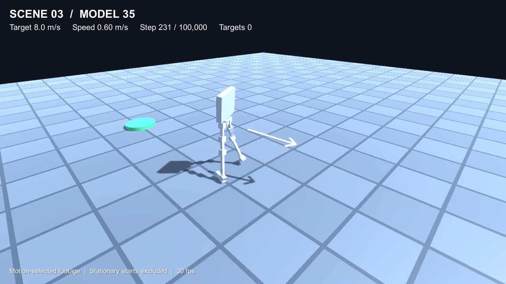
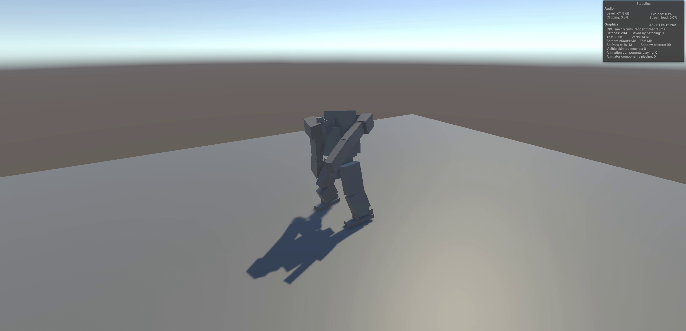
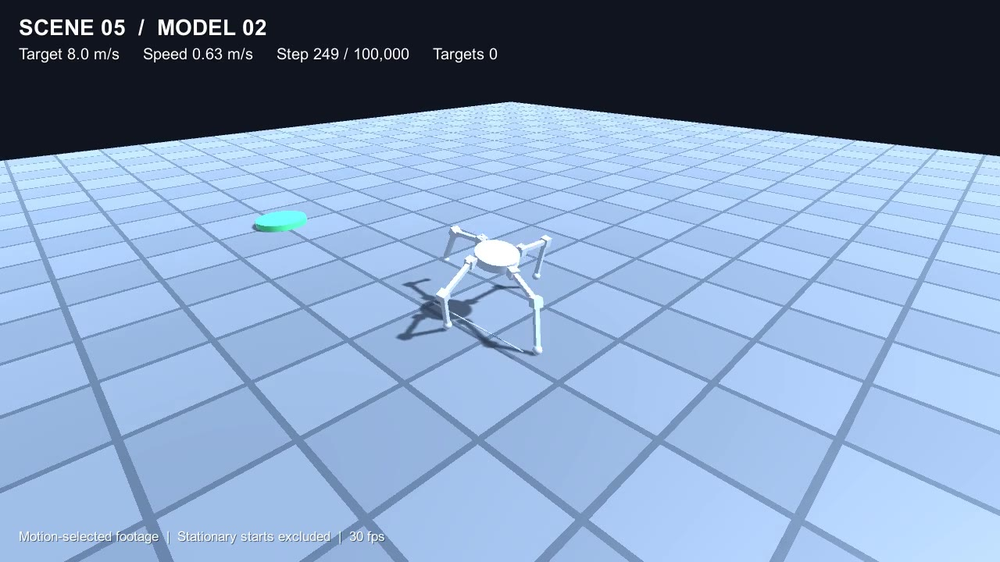
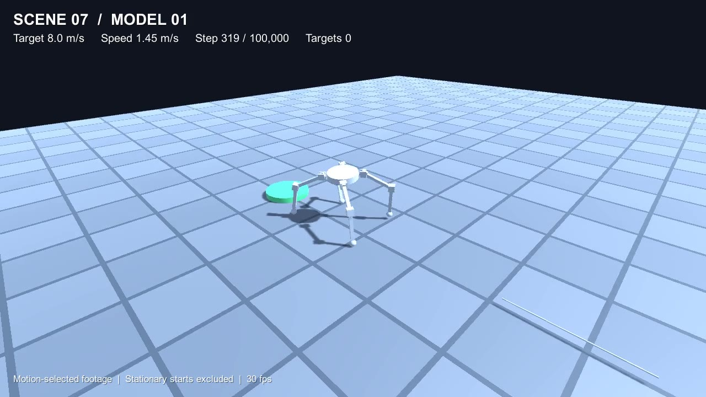
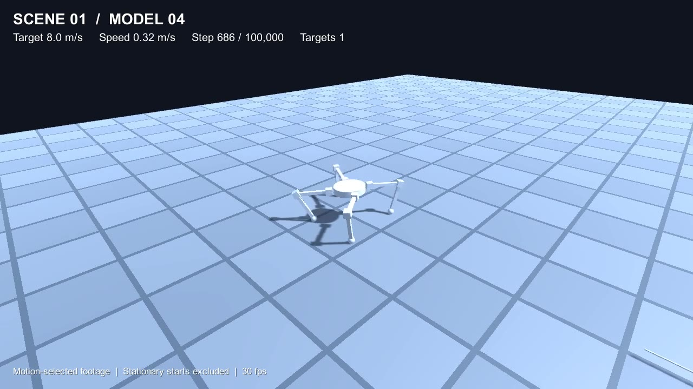

# Robot_ML · 물리 기반 보행 학습

- **개발 기간:** 2025.01 ~ 2025.08
- **사용 기술:** Unity, C#, ML-Agents, 물리 기반 관절 제어
- **구현 범위:** 프로젝트 설계 및 구현 전반

## 이족 보행

AI가 관절을 직접 제어하는 방식과, 삼각함수로 만든 기본 동작을 AI가 보조하는 방식을 시도했습니다. **각 미리보기를 누르면 시연 영상이 열립니다.**

### AI 관절 제어

관절별 힘과 목표 각도를 AI가 출력해 보행을 학습합니다.

[영상 보기](Recordings/Speed8/Scene03_Model35_speed8.mp4)

### 삼각함수 기반 동작 + AI 보조

삼각함수로 다리의 기본 움직임을 만들고, AI가 그 움직임을 보조하도록 구성했습니다.

[영상 보기](Recordings/Trigonometric/trigonometric-ai-bipedal.mp4)

## 사족 보행

대칭형 몸체에서 다리의 역할과 관절 출력 구조를 바꾸며 보행을 학습했습니다.

### 관절별 독립 제어

다리 순서를 재배치하지 않고, 각 관절의 힘과 목표 각도를 독립적으로 출력합니다.

[영상 보기](Recordings/Speed8/Scene05_Model02_speed8.mp4)

### 목표 방향 기준 다리 역할 구분

목표를 바라보는 방향을 기준으로 다리 순서를 맞춥니다. 몸체가 돌아가도 같은 순서의 다리가 같은 방향의 역할을 학습하도록 했습니다.

[영상 보기](Recordings/Speed8/Scene07_Model01_speed8.mp4)

### 다리 역할 구분 + 기준값·차이값 제어

다리 순서를 맞추고, 기준값과 차이값의 조합으로 12개 관절의 목표 각도를 계산합니다. 관절의 힘은 개별적으로 제어합니다.

[영상 보기](Recordings/Speed8/Scene01_Model04_speed8.mp4)

